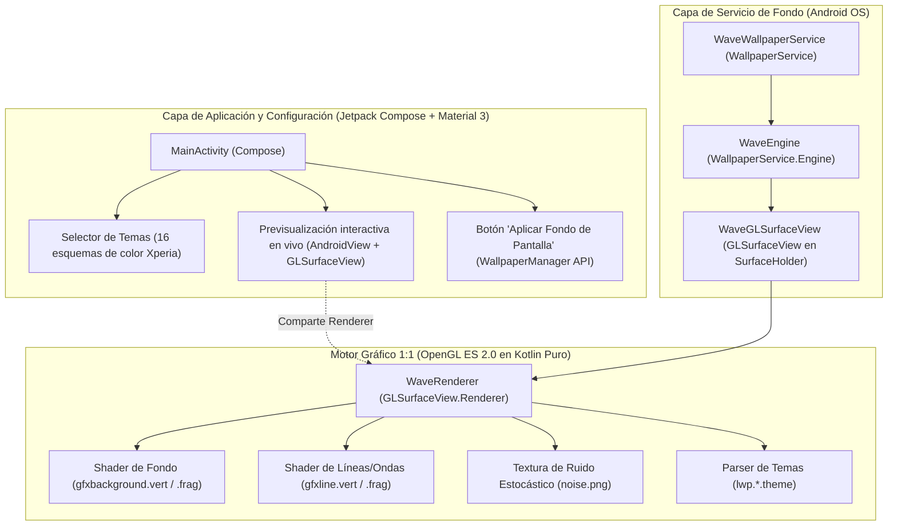

# Plan de Implementación: Wave — Live Wallpaper 1:1 (Sony Xperia "Experience Flow")

## 1. Resumen Ejecutivo y Objetivo

El objetivo de este proyecto es reimplementar de forma idéntica (1:1) el icónico fondo de pantalla animado **"Experience Flow" de Sony Xperia** (nombre clave: **Wave**) para dispositivos Android modernos, resolviendo la incompatibilidad de las librerías nativas antiguas de 32 bits de 2013 y modernizando la experiencia de usuario con **Jetpack Compose**.

---

## 2. Arquitectura del Sistema (Híbrida de Alto Rendimiento)



### ¿Por qué esta arquitectura?
* **Motor del Wallpaper en OpenGL ES 2.0**: Un `WallpaperService` no admite vistas normales de Android sin sobrecarga extrema. Con OpenGL ES 2.0 nativo sobre la GPU, las ondas y el fondo corren a **60 / 120 FPS fluidos con mínimo consumo de batería**.
* **UI en Jetpack Compose**: Reemplaza el menú anticuado de 2013 con una aplicación moderna, animada, con Material 3, selector visual de colores y previsualización en vivo.

---

## 3. Fases de Implementación Paso a Paso

### Fase 1: Limpieza del Entorno y Corrección de Compilación
* **1.1. Limpieza de artefactos corruptos**:
  * Eliminar la cadena corrupta `PY` agregada al final de todos los archivos (`build.gradle.kts`, `settings.gradle.kts`, `app/build.gradle.kts`, `AndroidManifest.xml`, recursos XML y archivos Kotlin).
* **1.2. Configuración moderna de Gradle y Compose**:
  * Configurar Android Gradle Plugin (AGP 8.5+), Kotlin 2.0.
  * Habilitar soporte para Jetpack Compose en `app/build.gradle.kts`:
    * `buildFeatures { compose = true }`
    * Añadir dependencias: `androidx.compose.material3`, `androidx.activity:activity-compose`, `androidx.compose.ui:ui-tooling-preview`.
* **1.3. Gradle Wrapper**:
  * Asegurar la presencia de los scripts `gradlew` / `gradlew.bat` para compilar de forma autónoma.

### Fase 2: Gestión de Assets y Parser de Temas (`ThemeParser`)
* **2.1. Parser de archivos `.theme`**:
  * Implementar el lector para los archivos `lwp.0.theme` a `lwp.15.theme` presentes en `assets/`.
  * Extraer los parámetros:
    * Colores de fondo: `bgc1`, `bgc2`, `bgc3`, `bgc4` (RGBA).
    * Colores de las líneas: `lc1` a `lc6` (RGBA).
    * Rangos de onda: `curveAmplitudeRange`, `curveFrequencyRange`, `curveWidthRange`, `curveSpeedRange`, `curveOffsetRange`, `curveBendRange`.
    * Parámetros de ruido y escala: `noiseTextureScale`, `lineCount`.
* **2.2. Modelo de datos**:
  * Crear la clase `WaveTheme` tipada con valores por defecto seguros.

### Fase 3: Motor Gráfico 1:1 en OpenGL ES 2.0 (`WaveRenderer`)
* **3.1. Carga y compilación de Shaders**:
  * Compilar `gfxbackground.vert` y `gfxbackground.frag` para el fondo dinámico.
  * Compilar `gfxline.vert` y `gfxlineA.frag` / `gfxlineB.frag` para las ondas luminosas.
* **3.2. Carga de textura `noise.png`**:
  * Cargar la textura de ruido estocástico desde `assets/noise.png` a la memoria de la GPU (formato GL_RGBA, filtros de interpolación lineal y repetición/clamp).
* **3.3. Geometría y bucle de renderizado**:
  * Render del quad a pantalla completa para el fondo animado.
  * Generación de las tiras de líneas sinusoidales moduladas por la textura de ruido y el tiempo `u_time`.
* **3.4. Interactividad táctil**:
  * Responder a eventos `touchDown`, `touchMove` y `touchUp` alterando las ondas dinámicamente con retorno suave.

### Fase 4: Infraestructura del Live Wallpaper (`WallpaperService`)
* **4.1. `WaveWallpaperService` y `WaveEngine`**:
  * Conectar el ciclo de vida del servicio (`onCreateEngine`, `onSurfaceCreated`, `onVisibilityChanged`, `onDestroy`).
* **4.2. Eficiencia energética**:
  * Pausar el renderizado inmediatamente cuando la pantalla se apague o cuando el usuario esté dentro de una app a pantalla completa (`onVisibilityChanged(false)`).
* **4.3. Propagación de toques desde el Launcher**:
  * Conectar `onTouchEvent` y `onCommand` (`POINTER_DOWN`, `POINTER_MOVE`, `POINTER_UP`, `ACCELERATE`) al renderizador.

### Fase 5: Interfaz de Usuario en Jetpack Compose (Material 3)
* **5.1. `MainActivity.kt`**:
  * Diseñar una interfaz limpia y atractiva con tema Material 3 Dark/Dynamic.
* **5.2. Previsualización en vivo (Live Preview)**:
  * Embeber el `GLSurfaceView` dentro de Compose usando `AndroidView`, permitiendo al usuario interactuar con las ondas antes de aplicarlas.
* **5.3. Selector de temas y paletas**:
  * Carrusel / cuadrícula con los 16 esquemas de color clásicos de Sony Xperia (Azul Xperia, Púrpura, Rubí, Esmeralda, Obsidiana, etc.).
* **5.4. Integración con el sistema**:
  * Botón para abrir el diálogo del sistema Android (`WallpaperManager.ACTION_CHANGE_LIVE_WALLPAPER`) para aplicar el Live Wallpaper con 1 clic.

### Fase 6: Validación, Compilación y Pruebas
* **6.1. Auditoría de código y linter**:
  * Verificación AST y ausencia de advertencias o fugas de memoria en buffers GL.
* **6.2. Compilación del APK**:
  * Ejecutar `./gradlew assembleDebug` para generar el instalador `.apk`.
* **6.3. Verificación de ejecución**:
  * Comprobar que no existan dependencias nativas faltantes (`UnsatisfiedLinkError`) y que el wallpaper corra de forma fluida.

---

## 4. Estructura Final del Código Fuente

```
wave_clone/
├── app/
│   ├── src/main/
│   │   ├── AndroidManifest.xml
│   │   ├── assets/                      # Shaders GLSL, noise.png, lwp.*.theme
│   │   ├── java/com/wave/wallpaper/
│   │   │   ├── MainActivity.kt          # UI en Jetpack Compose (Material 3)
│   │   │   ├── ui/
│   │   │   │   ├── Theme.kt             # Tema Material 3
│   │   │   │   ├── WallpaperPreview.kt  # Componente Compose para previsualizar GL
│   │   │   │   └── ColorSelector.kt     # Selector de los 16 temas
│   │   │   ├── service/
│   │   │   │   ├── WaveWallpaperService.kt # WallpaperService + Engine
│   │   │   │   └── WaveGLSurfaceView.kt
│   │   │   ├── gl/
│   │   │   │   ├── WaveRenderer.kt      # Renderer OpenGL ES 2.0
│   │   │   │   ├── ShaderUtil.kt        # Compilación de shaders GLSL
│   │   │   │   ├── TextureUtil.kt       # Carga de noise.png
│   │   │   │   └── WaveGeometry.kt      # Generación de curvas
│   │   │   ├── model/
│   │   │   │   ├── WaveTheme.kt         # Modelo de datos del tema
│   │   │   │   └── ThemeParser.kt       # Parser de archivos lwp.*.theme
│   │   │   └── util/
│   │   │       └── PreferencesManager.kt # Persistencia de tema elegido
│   │   └── res/
│   │       ├── values/strings.xml
│   │       └── xml/wallpaper.xml
│   └── build.gradle.kts
├── build.gradle.kts
├── settings.gradle.kts
└── plan_de_implementacion.md
```
